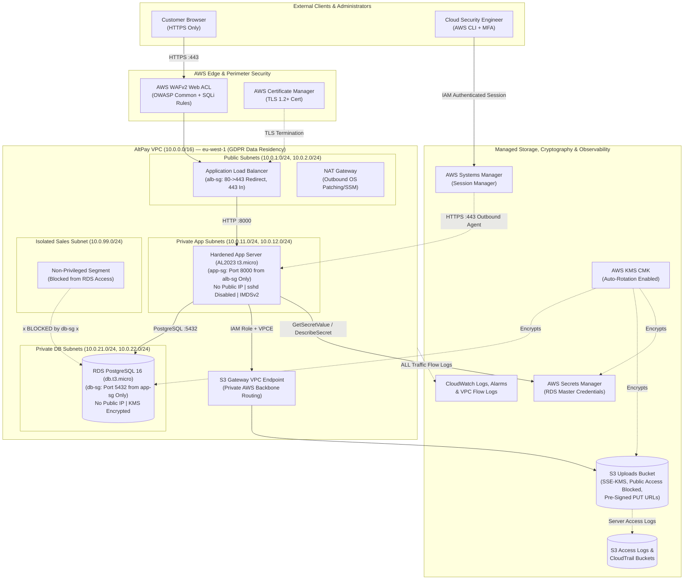
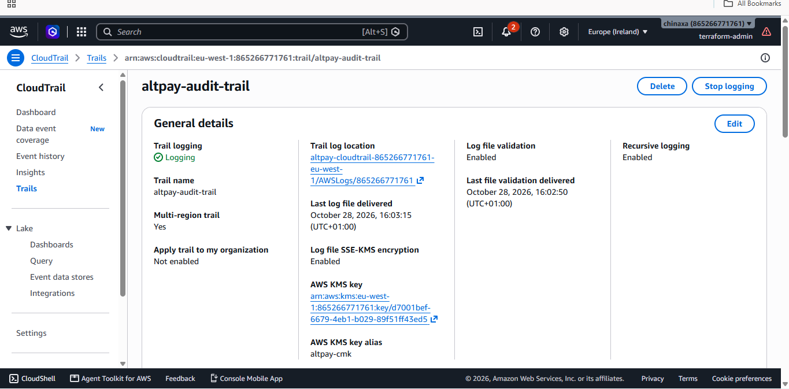

# AltPay Secure Cloud Infrastructure: Hardened Three-Tier Payment Portal on AWS


> **Executive Summary:** Designed, provisioned, and hardened a compliant three-tier web application architecture on AWS (`eu-west-1`) using Terraform for AltPay, a fast-growing digital payments startup serving financial institutions across Africa and the European Union. This architecture eliminates public exposure of compute and database layers, enforces envelope encryption at rest via a Customer Managed Key (AWS KMS CMK) and TLS 1.2+ in transit, replaces static credentials and SSH bastions with short-lived IAM Roles (IMDSv2) and AWS Systems Manager Session Manager, and establishes full-stack auditability across AWS CloudTrail, VPC Flow Logs, CloudWatch Alarms, and AWS WAFv2.

---

## Table of Contents
- [Tools Used](#tools-used)
- [Skills Learned](#skills-learned)
- [1. Problem Statement & Objectives](#1-problem-statement--objectives)
- [2. Architecture & Design Overview](#2-architecture--design-overview)
- [3. Technology Stack & Tooling](#3-technology-stack--tooling)
- [4. Full Documentation Index](#4-full-documentation-index)
- [5. Implementation Walkthrough](#5-implementation-walkthrough)
- [6. Validation, Testing & Proof of Work](#6-validation-testing--proof-of-work)
- [7. Key Challenges & Trade-Offs](#7-key-challenges--trade-offs)
- [8. Future Enhancements](#8-future-enhancements)
- [Author & Contact](#author--contact)

---

## Tools Used

**Infrastructure, Cloud & Platforms**  


**Application, Scripting & Databases**  


**Security, Governance & Observability**  


---

## Skills Learned

**Architecture & Engineering**  


**Security Operations & Testing**  


---

## 1. Problem Statement & Objectives

### Background & Risk / Bottleneck
AltPay, a subsidiary of AltSchool Africa, processes payment metadata for small banks and fintechs across Africa and the European Union. Operating across these jurisdictions requires hosting both a public-facing customer portal (supporting document/invoice uploads) and an internal admin dashboard while adhering to strict data-protection regulations (EU GDPR and African data-protection laws such as the Nigeria Data Protection Act). Without a hardened multi-tier cloud foundation, payment startups face critical risks: publicly exposed databases, long-lived AWS credentials leaked in source code, unencrypted customer uploads in public S3 buckets, unrestricted SSH/RDP management ports, and a lack of forensic audit trails.

### Core Objectives
* **Objective 1 — Multi-Tier Network Isolation:** Architect a segmented VPC (`10.0.0.0/16`) in `eu-west-1` (Ireland) with Public, Private Application, Private Database, and Isolated Sales subnets, ensuring zero public IPs on application or database hosts and strict tier-to-tier security group chaining.
* **Objective 2 — Identity, Least Privilege & Zero-SSH Administration:** Eliminate hardcoded secrets and SSH bastion hosts by enforcing EC2 Instance Metadata Service v2 (IMDSv2), prefix-scoped IAM Role policies (`uploads/*`), MFA-enforced console administration, and AWS Systems Manager (SSM) Session Manager.
* **Objective 3 — End-to-End Cryptographic Data Protection:** Encrypt all data at rest (RDS PostgreSQL, S3 Uploads, EBS volumes, Secrets Manager, and CloudTrail/CloudWatch logs) using an auto-rotating AWS KMS Customer Managed Key (CMK), and enforce TLS 1.2+ with strict HTTP security headers and server-side validated S3 pre-signed URLs.
* **Objective 4 — Comprehensive Audit Logging & Threat Detection:** Establish full visibility across API calls, network flows, and application health using multi-region AWS CloudTrail, VPC Flow Logs, S3 Server Access Logs, AWS WAFv2 (OWASP Core & SQLi rule sets), and CloudWatch metric alarms.

> [!IMPORTANT]
> **Scope Note:** This repository contains the complete Terraform Infrastructure-as-Code (IaC) templates, custom least-privilege IAM policy JSON definitions, KMS & Secrets Manager metadata, empirical validation proofs, and Security Justification documentation for the AltPay assessment.

---

## 2. Architecture & Design Overview

### System Workflow (Mermaid Diagram)



### Key Design Decisions
1. **Strict Security Group Chaining (`alb-sg` → `app-sg` → `db-sg`):** Instead of using broad CIDR blocks in internal firewall rules, security groups reference the upstream security group ID directly. `altpay-app-sg` (`sg-067c31c5212515915`) only accepts TCP port `8000` from `altpay-alb-sg` (`sg-024acb052230a19fd`), and `altpay-db-sg` (`sg-05ae81e2cdde75d94`) only accepts TCP port `5432` from `altpay-app-sg`.
2. **Zero-SSH Architecture via AWS Systems Manager (SSM) & IMDSv2:** Port `22` is completely omitted from all security groups, and the OpenSSH daemon (`sshd`) is stopped and disabled during OS bootstrapping. Administrative debugging is performed exclusively over outbound HTTPS (`443`) via AWS SSM Session Manager, while IMDSv2 (`http_tokens = required`, hop limit `1`) prevents SSRF attacks from stealing temporary IAM role credentials.
3. **Server-Side Validated S3 Pre-Signed URLs over AWS Backbone:** Rather than allowing direct public writes or proxying large file payloads through the application server, the Flask API validates the filename and MIME type server-side (`.pdf`, `.png`, `.jpg`, `.jpeg`) and generates a 300-second S3 pre-signed `PUT` URL enforced with `aws:kms` encryption and routed privately via an S3 Gateway VPC Endpoint (`vpce-0ea9433805dc0e6a5`).

---

## 3. Technology Stack & Tooling

| Category | Tool / Platform | Role in This Project | Why It Was Chosen |
| :--- | :--- | :--- | :--- |
| **Cloud Platform** | AWS (`eu-west-1` Ireland) | Primary hosting environment | Satisfies EU GDPR data residency requirements while fitting within AWS Free Tier (`t3.micro` / `db.t3.micro`). |
| **Infrastructure as Code** | Terraform (`v1.15+`, AWS Provider `v6.70.0`) | Automated provisioning & teardown | Guarantees deterministic, version-controlled deployment of all 49 cloud resources with zero configuration drift. |
| **Perimeter & Transport** | AWS ALB, ACM & AWS WAFv2 | Edge routing, TLS 1.2+ & OWASP filtering | Terminates TLS using `ELBSecurityPolicy-TLS13-1-2-2021-06`, redirects HTTP to HTTPS (`301`), and blocks SQLi/XSS at the edge. |
| **Compute & App Layer** | Amazon Linux 2023 EC2 (`t3.micro`), Python Flask, Gunicorn | Private application tier | Runs as an unprivileged system user (`altpayapp`), injects HSTS/CSP security headers, and enforces upload validation. |
| **Database & Storage** | Amazon RDS PostgreSQL 16 (`db.t3.micro`) & Amazon S3 | Persistent relational & object storage | Provides private, KMS-encrypted storage with automated backups, public access blocks, and TLS-only bucket policies. |
| **Secrets & Cryptography** | AWS KMS (CMK) & AWS Secrets Manager | Envelope encryption & credential storage | Eliminates hardcoded passwords in code; centralizes key rotation and cryptographic access control. |
| **Audit & Monitoring** | AWS CloudTrail, VPC Flow Logs, CloudWatch Alarms | Security telemetry & anomaly alerting | Captures management API events, network `ACCEPT`/`REJECT` flows, S3 access logs, and triggers alarms on HTTP `5XX` spikes. |

---

## 4. Full Documentation Index

Browse the dedicated documentation modules in this repository for deep-dive technical specifications, reproduction guides, and operational runbooks:

| Document | Description |
| :--- | :--- |
| [**`architecture.md`**](./architecture.md) | Deep dive into VPC topology, subnet allocations, security group matrices, IAM role flows, KMS cryptography, and deployed resource ARNs. |
| [**`setup.md`**](./setup.md) | Step-by-step prerequisites, AWS CLI/SSM setup, Terraform deployment workflow, validation commands, and cost-control teardown instructions. |
| [**`troubleshooting.md`**](./troubleshooting.md) | Operational runbook covering real-world issues encountered during deployment (PostgreSQL 16 engine versions, KMS policies, PowerShell `curl.exe` parsing, and SSM variable scoping) and their exact resolutions. |
| [**`Security_Justification_Document.md`**](./Security_Justification_Document.md) | Formal security report detailing IAM least-privilege justifications, Shared Responsibility Model mapping, Top 5 Threat Model, and residual risk recommendations. |
| [**`Cleanup_Instructions.md`**](./Cleanup_Instructions.md) | Quick-reference commands to destroy all billable AWS resources and verify a clean account state. |

---

## 5. Implementation Walkthrough

### Phase 1: Segmented VPC & Least-Privilege Network Controls
Provisioned `altpay-vpc` (`vpc-0b1ccba5d30aaa613`) across `eu-west-1a` and `eu-west-1b` with dedicated Public, Private App, Private DB, and Isolated Sales subnets, alongside an S3 Gateway VPC Endpoint (`vpce-0ea9433805dc0e6a5`) and NAT Gateway (`nat-096302182dbfe63c9`). Configured tiered security groups that restrict traffic strictly to required application ports.


*Figure 1: VPC Security Groups (`altpay-alb-sg`, `altpay-app-sg`, `altpay-db-sg`) enforcing strict tier-to-tier isolation in `eu-west-1`.*


*Figure 2: `altpay-app-sg` (`sg-067c31c5212515915`) inbound rule permitting TCP port 8000 exclusively from `altpay-alb-sg` (`sg-024acb052230a19fd`) and outbound HTTPS (443) + PostgreSQL (5432).*

### Phase 2: Identity & Access Management (IAM) and Host Hardening
Created the `altpay-ec2-app-role` IAM role and attached three least-privilege policies: `altpay-app-s3-access` (restricting `s3:GetObject` and `s3:PutObject` strictly to `arn:aws:s3:::altpay-uploads-865266771761-eu-west-1/uploads/*` and `secretsmanager:GetSecretValue` to the single RDS secret ARN), `altpay-monitoring-policy`, and `AmazonSSMManagedInstanceCore`. Created `altpay-enforce-admin-mfa` to require MFA for console users. Hardened the EC2 instance (`i-00745caf3b19355fd`) by disabling SSH password authentication, stopping `sshd`, enforcing IMDSv2, and running the Gunicorn/Flask app under the non-root `altpayapp` user.


*Figure 3: `altpay-ec2-app-role` (`arn:aws:iam::865266771761:role/altpay-ec2-app-role`) with attached least-privilege policies.*


*Figure 4: Customer-managed least-privilege IAM policies (`altpay-app-s3-access`, `altpay-enforce-admin-mfa`, `altpay-monitoring-policy`) in the IAM Console.*

<details>
<summary><strong>Click to expand: Least-Privilege Application IAM Policy (<code>iam-policies/app-s3-access.json</code>)</strong></summary>

```json
{
  "Version": "2012-10-17",
  "Statement": [
    {
      "Sid": "LeastPrivilegeS3UploadsPrefixOnly",
      "Effect": "Allow",
      "Action": [
        "s3:GetObject",
        "s3:PutObject"
      ],
      "Resource": "arn:aws:s3:::altpay-uploads-865266771761-eu-west-1/uploads/*"
    },
    {
      "Sid": "ReadDatabaseCredentialsSecret",
      "Effect": "Allow",
      "Action": [
        "secretsmanager:GetSecretValue",
        "secretsmanager:DescribeSecret"
      ],
      "Resource": "arn:aws:secretsmanager:eu-west-1:865266771761:secret:altpay/prod/rds-credentials-v1-VND5ox"
    },
    {
      "Sid": "AllowKMSCryptoForS3AndSecrets",
      "Effect": "Allow",
      "Action": [
        "kms:Decrypt",
        "kms:GenerateDataKey"
      ],
      "Resource": "arn:aws:kms:eu-west-1:865266771761:key/d7001bef-6679-4eb1-b029-89f51ff43ed5"
    }
  ]
}
```

</details>

### Phase 3: KMS Envelope Encryption, S3 Object Security & Private RDS Database
Provisioned a KMS Customer Managed Key (`alias/altpay-cmk`, key ID `d7001bef-6679-4eb1-b029-89f51ff43ed5`) with automatic annual rotation. Configured `altpay-uploads-865266771761-eu-west-1` with SSE-KMS encryption, Bucket Key enabled, all four Public Access Block settings turned on, a bucket policy denying non-TLS (`aws:SecureTransport = false`) requests, and server access logging to `altpay-access-logs-865266771761-eu-west-1`. Deployed RDS PostgreSQL 16.13 (`altpay-postgres-db`) in private DB subnets with storage encryption enabled, `publicly_accessible = false`, automated backup snapshots, and master credentials stored in AWS Secrets Manager (`altpay/prod/rds-credentials-v1`).


*Figure 5: S3 bucket `altpay-uploads-865266771761-eu-west-1` showing Block All Public Access set to `On` and Server-Side Encryption with AWS KMS (`SSE-KMS`) enabled.*


*Figure 6: RDS PostgreSQL instance `altpay-postgres-db` deployed in `altpay-db-subnet-group` with KMS encryption at rest enabled.*

### Phase 4: Edge TLS Termination (ALB + WAFv2) & Comprehensive Logging
Deployed the internet-facing Application Load Balancer (`altpay-public-alb`) associated with an AWS WAFv2 Web ACL (`altpay-waf-acl`) enforcing `AWSManagedRulesCommonRuleSet` and `AWSManagedRulesSQLiRuleSet`. Configured Listener `:80` to issue a `301` redirect to `HTTPS:443` using security policy `ELBSecurityPolicy-TLS13-1-2-2021-06` and ACM certificate `arn:aws:acm:eu-west-1:865266771761:certificate/de768941-af4e-42e0-987a-0b6233b9c178`. Enabled multi-region AWS CloudTrail (`altpay-audit-trail`) with log file validation, VPC Flow Logs (`/altpay/vpc/flow-logs`), and a CloudWatch Alarm (`altpay-alb-high-5xx-alarm`).


*Figure 7: Public Application Load Balancer (`altpay-public-alb`) active across `eu-west-1a` and `eu-west-1b` with AWS WAFv2 Web ACL integrated.*


*Figure 8: ALB Listeners showing HTTP:80 permanent 301 redirect to HTTPS:443 and ACM certificate attachment.*


*Figure 9: Multi-region CloudTrail `altpay-audit-trail` encrypted with `altpay-cmk` and delivering logs to `altpay-cloudtrail-865266771761-eu-west-1`.*


*Figure 10: CloudWatch Metric Alarm `altpay-alb-high-5xx-alarm` monitoring `HTTPCode_Target_5XX_Count` on the Application Load Balancer.*

---

## 6. Validation, Testing & Proof of Work

All functional and security acceptance criteria were empirically verified against the live deployment in `eu-west-1`.

### Baseline vs. Post-Implementation Results

| Metric / Test Scenario | Baseline (Unsecured) | Post-Implementation (AltPay Hardened) | Status |
| :--- | :--- | :--- | :--- |
| **1. Transport Security & HTTP Headers** | Plaintext HTTP; missing HSTS/CSP headers | HTTP `301` redirects to HTTPS (TLS 1.2+); returns `200 OK` with `Strict-Transport-Security`, `Content-Security-Policy`, `X-Frame-Options: DENY`, `X-Content-Type-Options: nosniff`, and `Secure; HttpOnly; SameSite=Strict` cookies | Passed |
| **2. File Upload Validation & Storage** | Direct public bucket writes; unrestricted file types | `.exe` uploads rejected (`400 Bad Request`); valid `.pdf` uploads receive a 300-second SSE-KMS pre-signed S3 `PUT` URL scoped to `uploads/*` | Passed |
| **3. Unauthorized Admin Access** | Exposed internal endpoints | Unauthenticated requests to `/admin` blocked with `401 Unauthorized` | Passed |
| **4. Network Isolation & Lateral Movement** | Direct public IPs & open SSH/DB ports | Zero public IPs on EC2/RDS; App-to-RDS port `5432` succeeds while port `22` is blocked and logged as `REJECT` in VPC Flow Logs | Passed |
| **5. IAM Role & Secrets Audit Trail** | Static AWS keys in `.env` files; no audit logs | Zero static keys; `AssumeRole` and `DescribeSecret` events recorded with full attribution in AWS CloudTrail | Passed |

### Visual Evidence

#### Proof 1: Terraform Provisioning, HTTPS `200 OK`, Security Headers & Upload Validation

*Figure 11: Successful `terraform apply` provisioning all 49 resources and outputting the ALB HTTPS endpoint, private EC2 ID, RDS endpoint, S3 bucket, KMS CMK ARN, and Secrets Manager ARN.*


*Figure 12: `curl.exe -I` proving HTTP-to-HTTPS `301 Moved Permanently` redirect, and `curl.exe -k -i` proving `HTTP/1.1 200 OK` with `Content-Security-Policy`, `Strict-Transport-Security`, `X-Content-Type-Options: nosniff`, `X-Frame-Options: DENY`, and `Secure; HttpOnly; SameSite=Strict` cookies.*


*Figure 13: Server-side upload validation issuing a temporary SSE-KMS pre-signed URL (`200 OK`) for `invoice.pdf`.*


*Figure 14: Server-side upload validation rejecting `payload.exe` (`application/octet-stream`) with `HTTP/1.1 400 BAD REQUEST` (`{"error":"Invalid file type. Allowed: pdf, png, jpg"}`).*


*Figure 15: Unauthenticated `GET /admin` request blocked with `HTTP/1.1 401 UNAUTHORIZED`.*

#### Proof 2: SSM Session Manager, Network Isolation & VPC Flow Logs `REJECT` Proof

*Figure 16: Inside the private EC2 instance (`10.0.11.215`) via AWS SSM Session Manager: TCP connection to RDS (`10.0.21.253`) on PostgreSQL port `5432` succeeds (`accepting connections`), whereas connection on port `22` is blocked by `altpay-db-sg`.*


*Figure 17: Querying `/altpay/vpc/flow-logs` via AWS CLI confirming `REJECT OK` flow records for unauthorized port probes.*


*Figure 18: CloudWatch Logs console showing captured VPC Flow Log streams (`eni-033b02d8932c52feb-all`) inside `/altpay/vpc/flow-logs`.*

#### Proof 3: CloudTrail API & IAM Role Assumption Evidence

*Figure 19: AWS CloudTrail Event History recording management API calls (`CreateBucket`, `RunInstances`, `CreateTrail`) with timestamps and resource identifiers.*


*Figure 20: AWS CloudTrail lookup confirming `AssumeRole` events executed by `altpay-ec2-app-role` on instance `i-00745caf3b19355fd`.*


*Figure 21: AWS CloudTrail lookup confirming the EC2 instance role (`i-00745caf3b19355fd`) securely accessing Secrets Manager metadata without static credentials.*

---

## 7. Key Challenges & Trade-Offs

> [!NOTE]
> Documenting engineering roadblocks and architectural trade-offs demonstrates practical cloud security troubleshooting and cost-aware design.

* **Challenge 1: KMS Key Policy Permissions for CloudWatch Logs Encryption**
  * *Issue:* During initial `terraform apply`, creating the KMS-encrypted CloudWatch Log Groups (`/altpay/app/portal` and `/altpay/vpc/flow-logs`) failed because the regional CloudWatch Logs service principal (`logs.eu-west-1.amazonaws.com`) requires explicit `kms:Encrypt` and `kms:ReEncrypt*` permissions in the KMS key policy in addition to `kms:GenerateDataKey*`.
  * *Resolution:* Updated the `AllowCloudTrailAndLogsToEncrypt` statement in `terraform/kms_secrets.tf` to grant `kms:Encrypt`, `kms:ReEncrypt*`, `kms:GenerateDataKey*`, `kms:Decrypt`, and `kms:DescribeKey` to `logs.eu-west-1.amazonaws.com`.
* **Challenge 2: RDS PostgreSQL Minor Version Availability & Free-Tier Backup Retention Limits**
  * *Issue:* Hardcoding `engine_version = "16.3"` caused an RDS parameter error because AWS had promoted `16.13` as the active default minor release in `eu-west-1`, and Free-Tier accounts restrict certain extended backup retention settings.
  * *Resolution:* Specified major version `"16"` (which automatically resolved to `16.13`) and configured `backup_retention_period = 1` with `copy_tags_to_snapshot = true`, satisfying automated encrypted backup requirements within Free-Tier guardrails.
* **Challenge 3: Environment Variable Scoping Across Windows PowerShell and Remote Linux SSM Shells**
  * *Issue:* Running `timeout 3 bash -c "</dev/tcp/$RDS_HOST/5432"` inside the remote `aws ssm start-session` shell initially failed with `/dev/tcp//5432: Invalid argument` because `$RDS_HOST` was defined in the local Windows PowerShell session rather than the remote Linux environment. * *Resolution:* Exported `RDS_HOST` directly inside the remote `sh-5.2$` session (`export RDS_HOST="altpay-postgres-db.czek08ukwcnb.eu-west-1.rds.amazonaws.com"`), verified DNS resolution to `10.0.21.253` via `getent hosts`, and validated port `5432` (`SUCCESS` + `pg_isready`) vs. port `22` (`BLOCKED`).

---

## 8. Future Enhancements

- [ ] **Automated DevSecOps CI/CD Pipeline:** Integrate GitHub Actions running **Checkov** and **Trivy** for Terraform static analysis and **OWASP ZAP** for automated DAST scanning against the ALB endpoint prior to production promotion.
- [ ] **WAF Rate-Limiting & Bot Control:** Add an AWS WAFv2 rate-based rule (`1,000 requests per 5 minutes per IP`) scoped to `/api/presigned-upload` and `/admin` to mitigate credential stuffing and layer-7 DoS attacks.
- [ ] **Automated 30-Day Secret Rotation & Multi-AZ RDS:** Enable RDS Multi-AZ failover for production resilience and attach an AWS Secrets Manager rotation Lambda function to rotate the PostgreSQL master password every 30 days.
- [ ] **SAML 2.0 / OIDC Identity Federation:** Integrate the `/admin` dashboard with an enterprise Identity Provider (Okta / AWS IAM Identity Center) using OIDC authentication at the ALB listener level.

---

## Author & Contact

**Chinaza Nnamani**  
Cloud & Application Security Consultant | Penetration Testing Engineer  
* **Focus Areas:** Cloud Security Architecture (AWS/Azure), DevSecOps Automation, Web Application Penetration Testing, Infrastructure as Code (Terraform)